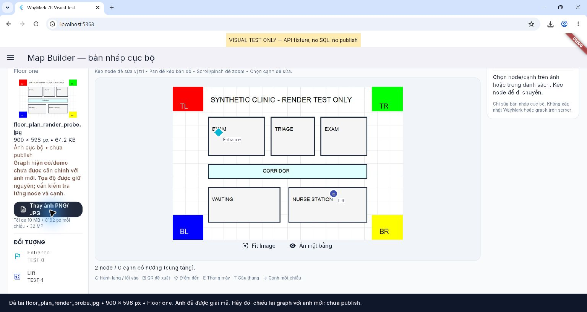

# Floor plan canvas rendering regression — 2026-10-19

## Final acceptance update

On 2026-10-19 the user confirmed **6/6 manual Chrome checks passed**: PNG/JPG on
the main canvas, undistorted Fit Image, hide/show, synchronized zoom/pan, node
dragging with route preview, and JSON v2 export/import restoring image and graph.
**GO for local drafts only; not production-ready.** This user-reported acceptance
supersedes the pending manual pan acceptance from the agent's earlier test
session below. Resize is covered by automated tests; it was not a separate item
in the user's six manual checks. This does not certify a production floor plan, accessibility or
server authorization; publication remains blocked pending Phase 7A.

## Root cause and evidence

Reproduced through Chrome's real file picker with `test/fixtures/floor_plan_render_probe.jpg`
(900 × 598, synthetic clinic: EXAM, TRIAGE, WAITING, NURSE STATION and corridor).
Validation reported successful decode, but the main canvas showed the grid. Opening
DevTools changed the responsive layout and exposed the thumbnail's error text:

`TypeError: Instance of '_UnmodifiableUint8ListView': type '_UnmodifiableUint8ListView' is not a subtype of type 'NativeUint8List'`

`FloorPlanAsset.validate` decoded the original native typed array, then stored an
immutable Dart view. Both the thumbnail and main canvas passed that view to
`MemoryImage`. On this Flutter 3.47.7 / Dart 3.13.5 Web debug runtime, the image
decoder's JS interop rejected the view. On the VM the same view decoded normally;
therefore VM-only image tests did not catch this platform failure.

The input file was not corrupt. No evidence supported invalid source/destination
rectangles, opaque graph coverage, zero opacity, viewport clipping, or premature
disposal of the validation frame as the triggering cause. Validation's temporary
frame and the canvas frame have separate ownership. The user's original clinic
JPG has not been supplied; the synthetic clinic reproduces the reported failure.

## Changes

- Keep draft `bytes` immutable. `FloorPlanAsset.imageProvider` lazily copies them
  into a native `Uint8List` once per asset; thumbnail and canvas reuse that provider.
  Editor rebuilds and node dragging do not allocate a new provider or reset zoom.
- Canvas retains and paints the decoded frame directly with `paintImage` and
  `BoxFit.contain`; image and graph share exactly one fitted rectangle and one
  `InteractiveViewer` transform. Graph paints after image without an opaque fill.
- Fix a separate state defect: a successful image frame now clears a previous
  error. Old stream callbacks cannot replace a newer source; replaced frames are
  released after painting, and listeners are removed on disposal.
- New image and viewport resize reset the transform. **Fit Image** resets it on
  demand. **Ẩn mặt bằng / Hiện mặt bằng** keeps image geometry and graph coordinates.
  Controls sit outside the image viewport so all four corners remain visible.
- Explicit empty/loading/render-error/hidden states. Warn that existing/demo
  graph has not been aligned to a newly chosen image. No automatic node movement.
- Fix UTF-8 response headers in the isolated visual harness (its initial mock
  response previously failed to encode a Unicode site name).

## Automated evidence

- PNG and JPG pixel tests validate all four colored corners on the **main canvas**,
  after fit, hide/show, resize, replacement, and shared image/graph zoom bounds.
- `test/goldens/floor_plan_clinic_canvas.png` contains the raster clinic rooms and
  a graph line/node overlay. It is a Flutter VM raster golden, not a Chrome screenshot.
- Regression checks: native rendering-byte type, immutable independent draft bytes,
  stable provider identity, error → valid frame recovery, detached stream isolation,
  normalized hit testing, draft export/import and drag under zoom.
- `flutter analyze`: no issues.
- `flutter test --reporter expanded`: 147 passed, 1 existing Web-only test skipped on VM.
- `flutter build web`: passed (55.9 s after the final provider change).
- `git diff --check`: passed; existing LF/CRLF conversion warnings only.

## Real Chrome evidence

After reloading the compiled application with the provider fix, repeated real
file-picker uploads of the JPG and PNG both displayed all clinic rooms, corridor,
four colored corners and overlay nodes in the main canvas. Observed scroll zoom,
**Fit Image** restoring all corners, and hide/show preserving node positions.
Pixel/bounds/hit-testing tests cover pan and resize; the physical pointer drag
attempt was not conclusive, so manual pan/resize acceptance remains part of the
checklist below. The browser harness used API fixtures, not a live backend or SQL.



The screenshot is a real Chrome capture, separate from the VM golden. This
verifies the rendering path with representative files; it does not claim the
user's original JPG or a production floor plan has been reviewed/aligned.

## Files touched in this fix

- `waymark/lib/features/admin/floor_plan_asset.dart`
- `waymark/lib/features/admin/draft_map_editor.dart`
- `waymark/lib/features/route/floor_plan_canvas.dart`
- `waymark/test/floor_plan_canvas_test.dart`
- `waymark/test/draft_floor_workflow_test.dart`
- `waymark/test/floor_plan_pixels_test.dart` (new)
- `waymark/test/support/map_builder_visual_main.dart`
- `waymark/test/fixtures/floor_plan_render_probe.png` / `.jpg` (new)
- `waymark/test/goldens/floor_plan_clinic_canvas.png` (new)
- This report and `evidence/floor-plan-canvas-chrome.jpg` (new)

No backend, schema, production data, secrets, Gradle configuration or Windows
generated files were changed by this fix. Existing Git changes are retained.

## Recheck with the real application

```powershell
cd D:\project\WayMark\waymark
flutter run -d chrome --dart-define=WAYMARK_API_BASE_URL=http://localhost:5121/api
```

Use the actual configured backend URL if different. Export any unsaved draft before
stopping an old Flutter run; this editor stores unsaved work in memory. Fully restart
the application to load the provider fix.

1. Sign in normally, open Map Builder, select Site → Building → Floor.
2. Choose `test/fixtures/floor_plan_render_probe.jpg` or `.png`.
3. Confirm rooms/corridor appear on the **large canvas**, not only the thumbnail.
4. Press **Fit Image**: red/green/blue/yellow corners must all be visible, with
   original 900:598 aspect ratio. Hide/show must affect only the background image.
5. Zoom/pan; drag a node; resize Chrome. Image/node/edge geometry must stay together.
6. Choose the original clinic image. Existing graph coordinates remain unchanged;
   align and review them manually before using local route preview.

For an isolated UI check without backend/SQL:

```powershell
flutter run -d chrome --web-port 5368 -t test/support/map_builder_visual_main.dart
```

The harness supplies read-only API fixtures and uses the actual editor, picker,
validator and canvas. It is not imported into production. Test/golden images are
not declared as application assets. No backend, production data or publication is involved.
